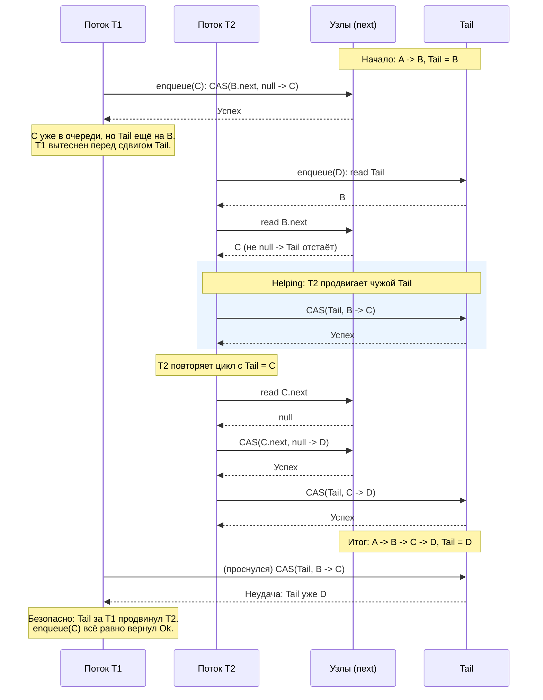

# Michael-Scott Queue (lock-free, helping, ABA)

## Обзор

Реализация **lock-free MPMC-очереди Майкла-Скотта** на связном списке узлов. Демонстрирует
механику **helping** (кооперативное дозавершение чужой операции), проблему **ABA** и её решение
через **tagged pointers**, а также разницу между sequential consistency и слабой моделью памяти
C11.

Узлы живут в **пуле фиксированной ёмкости** (`Box<[Node]>`), а "указатели" (`head`, `tail`,
`next`, голова freelist) - это упакованные `(index, version)` в одном `AtomicUsize`:

```rust
struct Node {
    value: AtomicUsize, // payload (usize), атомарный - см. раздел про реюз
    next: AtomicUsize,  // упакованный (index, version); index == NULL_INDEX -> конец
}

struct MSQueue {
    pool: Box<[Node]>,  // фиксированная ёмкость, без реаллокации; доступ по индексу
    free: AtomicUsize,  // голова freelist (Treiber-стек, tagged)
    head: AtomicUsize,  // упакованный указатель на dummy-узел
    tail: AtomicUsize,  // упакованный указатель на последний (или предпоследний) узел
}
```

> [!NOTE]
> Пул + индексы вместо реальных `AtomicPtr` выбраны специально: у `loom` нет настоящих адресов
> для битового тега поверх указателя, а сырой `AtomicPtr` + освобождение узлов дал бы
> недетерминированный use-after-free. Пул делает демонстрацию детерминированной и совместимой с
> `loom` / `Miri`. Ценой этого очередь имеет ограниченную ёмкость - сознательное упрощение.

## Структура и инвариант

Инвариант Майкла-Скотта: очередь **всегда непуста** за счёт **dummy-узла**. `head` указывает на
dummy (уже снятый элемент), `tail` - на последний узел или отстаёт на один шаг во время гонки.

```
head                           tail
  |                              |
  v                              v
[dummy] --next--> [A] --next--> [B] --next--> NULL
```

Ключевое свойство инварианта: **узел с `next == NULL` - это последний узел (хвост)**. Отсюда:
"у dummy нет преемника" эквивалентно "очередь пуста". Это свойство нам ещё понадобится.

## Helping - сердце алгоритма

`enqueue` состоит из **двух шагов**, и между ними структура на мгновение неконсистентна:

```rust
// шаг 1: пристегнуть новый узел к tail.next
if self.node(index_of(t)).next
    .compare_exchange(t_next, attach, Ordering::Release, Ordering::Relaxed)
    .is_ok()
{
    // шаг 2: продвинуть tail на новый узел (best-effort)
    let _ = self.tail.compare_exchange(
        t, pack(new_idx, version_of(t).wrapping_add(1)),
        Ordering::AcqRel, Ordering::Relaxed,
    );
    return Ok(());
}
```

Если поток успел сделать шаг 1, но ещё не сделал шаг 2 (или вытеснен между ними), `tail`
**отстаёт**: `tail.next != NULL`. Любой другой поток, наткнувшийся на это состояние (другой
`enqueue` или `dequeue`), **помогает**: сам продвигает `tail`, прежде чем действовать дальше.



Именно helping даёт **lock-freedom**: прогресс системы не зависит от того, доживёт ли конкретный
поток до конца своей операции.

## Почему move-семантика не решает освобождение узлов

Наивная мысль: "освобождать узлы move-семантикой Rust, ownership же всё отследит". Не работает:
реклэймейшн в lock-free это **вопрос времени выполнения**, а не типов.

- **Сырой индекс из-под атомика.** Поток A сделал `h = head.load()` (индекс `i`) и вытеснен.
  Поток B снял `i`, освободил его. A просыпается и читает `node(i).next` - **use-after-free**.
  Для borrow-checker `i` это просто `usize`, не заимствование; он не видит, что A ещё держит узел.
  Move-семантика опирается на **уникального** владельца, а узел здесь **разделяемо достижим**.

- **Окно в атомарном `Arc`.** Даже `Arc<Node>` не спасает из коробки: A загрузил указатель ->
  вытеснен -> B уронил refcount до 0, узел освобождён -> A делает `clone` (инкремент счётчика
  **освобождённого** узла) -> UAF. Это и есть проблема, ради которой существуют `arc-swap`,
  hazard pointers, epoch-based reclamation.

- **Payload тоже пришлось сделать атомарным.** Хотелось бы вынимать значение через `Option::take`
  (move `T`). Но при реюзе узла `dequeue`-чтение `value` конкурирует с `enqueue`-записью в тот же
  слот - **data race** (`loom` / `Miri` красные). Move-владение тут не спасает. Поэтому payload это
  `AtomicUsize` (очередь несёт `usize`): атомарные чтение и запись убирают UB. В общем случае
  (generic `T`, move) понадобились бы hazard pointers.

Вывод: move элегантно закрывает владение **данными**, но lock-free реклэймейшн **узлов** это про
конкурентных читателей, которых система типов не видит сквозь атомик.

## ABA и tagged pointers

Реюз узлов через freelist оживляет **ABA**:

```
Поток A (dequeue): прочитал head = (i, v). Готовит CAS(head: (i,v) -> (next_i, v+1)).
   <вытеснен перед CAS>
Поток B: dequeue(i) -> i в freelist -> enqueue переиспользовал i под новый узел,
         next теперь другой; head снова указывает на i.
Поток A: просыпается, CAS(head), ожидая (i, v).
```

- **Без тега** (сравниваем только индекс `i`): `expected == actual == i` -> CAS **ошибочно
  проходит**, хотя узел за это время стал другим -> потеря элемента и порча структуры.
- **С тегом**: реально там `(i, v+2)`, а ждём `(i, v)` -> CAS **проваливается**, A перечитывает.
  ABA обезврежена. См. тест `test_tag_detects_aba_that_index_only_would_miss`.

Что тег чинит и что нет:

- Тег (version-счётчик, растущий на каждом успешном CAS) **лечит ABA** и заодно гарантирует
  **консистентность прочитанного payload**: если `CAS(head)` в `dequeue` прошёл, значит `head` не
  сходил и вернулся к `(i, v)` (версии только растут) -> узел `next` не был переиспользован между
  чтением значения и CAS -> значение корректно.
- Тег **НЕ** освобождает память и **НЕ** устраняет data race сам по себе. Data race при реюзе
  устранён **атомарностью payload**. Настоящий `free` / возврат памяти ОС это hazard pointers /
  epoch-based reclamation (за рамками этого демо).

> [!IMPORTANT]
> Версии полей `next` должны быть **монотонны и переживать реюз узла**. Тег на attach-CAS
> защищает от ABA только если версия `next` растёт и не сбрасывается. Поэтому `free_node` и
> подготовка узла в `enqueue` **увеличивают** текущую версию, а не обнуляют её. Обнуление сделало
> бы тег вырожденным (версии `0` / `1`), и attach-CAS ошибочно проходил бы для реюзнутого узла.

## Пустота определяется по `next`, а не по сравнению `head` / `tail`

Тонкий, но принципиальный момент и отличная иллюстрация того, чем C11 отличается от sequential
consistency. Оригинальный алгоритм Майкла-Скотта (1996) доказан **в предположении sequential
consistency**. Наивный перенос `dequeue` выводит пустоту из сравнения `head` и `tail`:

```
h = head; t = tail; next = head.next
if index(h) == index(t):         // head == tail?
    if next == NULL: return None // пусто
    else: помочь продвинуть tail
else:                            // head != tail -> считаем, что элемент есть
    ... разыменовываем next ...  // ОПАСНО под слабой памятью
```

Под SC это корректно: если `head != tail`, то у dummy точно есть преемник (`head.next != NULL`),
глобально согласованный срез не даёт `head != tail` вместе с `head.next == NULL`.

**Под acquire/release такой срез возможен.** `Acquire`-загрузка `tail` вправе вернуть
**устаревшее** значение из modification order (acquire синхронизируется с тем, что прочитал, но не
обязан читать самое свежее). С реюзом узлов индекс хвоста прокручивается и возвращается, так что
старое `tail` может указывать на индекс, отличный от актуального. Реально пойманный `loom` / `Miri`
срез:

```
h    = (10, v46)   head - актуальный dummy
t    = (27, v86)   tail - УСТАРЕВШИЙ (реальный tail уже (10, v88), очередь пуста)
next = (NULL, _)   node(10).next - актуальный: преемника нет

index(h)=10 != index(t)=27  -> ветка else -> node(NULL) -> паника / UAF
```

Очередь **пуста** (`head == реальный tail`, `head.next == NULL`), но устаревший `tail` обманул
сравнение. Вывод: **источник истины о пустоте это только `next`**. Правильный `dequeue` проверяет
`is_null(next)` до и независимо от `head` / `tail`, а `tail` использует лишь чтобы решить, надо ли
помочь его продвинуть (и разыменовывает `next` только после `next != NULL`):

```rust
let h = self.head.load(Ordering::Acquire);
let next = self.node(index_of(h)).next.load(Ordering::Acquire);
if h != self.head.load(Ordering::Acquire) { continue; } // node(h) всё ещё dummy

if is_null(next) {
    return None; // пусто - решаем по next, НЕ по tail
}

let t = self.tail.load(Ordering::Acquire);
if index_of(h) == index_of(t) {
    // tail отстаёт -> помочь продвинуть и повторить
    let _ = self.tail.compare_exchange(
        t, pack(index_of(next), version_of(t).wrapping_add(1)),
        Ordering::AcqRel, Ordering::Relaxed,
    );
    continue;
}
// head != tail и преемник есть -> безопасно снять
```

Урок: инварианты, "очевидные" при sequential consistency, **не переносятся** на слабую модель
памяти без проверки. Согласованных срезов между независимыми атомиками там нет.

## Выбор Memory Order

Очередь строится на паре **Release/Acquire** (полный `SeqCst` не нужен): публикация узла и его
видимость получателю идут по цепочке release/acquire на поле `next`.

### Публикация узла: attach-CAS на `next` (`Release`), загрузки `next` (`Acquire`)

```rust
// enqueue, шаг 1: публикуем узел
self.node(index_of(t)).next
    .compare_exchange(t_next, attach, Ordering::Release, Ordering::Relaxed)
```

`enqueue` сначала пишет `value` и `next` нового узла (`Relaxed`), затем **публикует** узел через
attach-CAS с `Release`. Любой поток, прочитавший это поле `next` с `Acquire`, попадает в
отношение **synchronizes-with** с публикатором и через **happens-before** видит записанные `value`
и `next`. Поэтому `value` в `dequeue` можно грузить даже `Relaxed`: видимость обеспечивает
предшествующая `Acquire`-загрузка `next`, а не сама загрузка `value`.

### CAS над `head` / `tail` / `free`: `AcqRel`

Все три - точки, где RMW одновременно **публикует** своё изменение (release-часть) и **видит**
согласованный modification order атомика (acquire-часть). `AcqRel` на успехе, `Acquire` или
`Relaxed` на неуспешной ветке (мы просто перечитаем и повторим).

Version-тег в упакованном значении растёт на каждом успешном CAS и **переживает реюз** узла - это
и есть защита от ABA (см. выше). Монотонность тега `head` дополнительно гарантирует
консистентность прочитанного `value`: успешный `CAS(head, h -> ...)` доказывает, что `head` не
уходил и не возвращался к `h`, значит узел `next` не был переиспользован между чтением значения и
CAS.

### Первичные загрузки `head` / `tail` / `free`: `Acquire`

Загрузка должна попасть в **happens-before** с публикатором соответствующего изменения, чтобы
видеть связанные записи (узел за указателем, поле `next`). Важная оговорка из раздела про пустоту:
`Acquire` даёт видимость **того значения, которое реально прочитано**, но **не** гарантирует чтение
самого свежего значения. Поэтому по одиночной `Acquire`-загрузке `tail` нельзя делать вывод о
структуре очереди - решение о пустоте принимается по `next`.

## Итого

| Операция                        | Memory Order          | Причина                                                                                                 |
| ------------------------------- | --------------------- | ------------------------------------------------------------------------------------------------------- |
| `next` attach-CAS (success)     | `Release`             | Публикует новый узел (`value` + `next`) для потоков, читающих `next` с `Acquire`                        |
| `next.load`                     | `Acquire`             | Строит **synchronizes-with** с публикатором узла -> видимость `value` и связей                          |
| `value.store` (подготовка узла) | `Relaxed`             | Видимость обеспечит `Release` на attach-CAS ниже; сам узел ещё эксклюзивно наш                          |
| `value.load` (в `dequeue`)      | `Acquire`             | Видимость уже гарантирована `Acquire`-загрузкой `next`; тег `head` гарантирует, что значение "то самое" |
| `head` / `tail` / `free` CAS    | `AcqRel`              | RMW публикует изменение и видит **modification order**; version-тег переживает реюз -> защита от ABA    |
| `head` / `tail` / `free` load   | `Acquire`             | Видимость прочитанного значения; но НЕ гарантия свежести - пустоту решаем по `next`, не по `tail`       |
| CAS (failure branch)            | `Acquire` / `Relaxed` | Изменение не применилось - просто перечитываем и повторяем                                              |

Пара **Release/Acquire** это минимально необходимый и достаточный набор для корректной работы
очереди в рамках [декларативной модели памяти](../../README.md#11-порядки-и-отношения): она даёт
видимость данных узла через `next` и согласованный порядок обновлений `head` / `tail` через
**modification order**, без накладных расходов полного **synchronization order** (`SeqCst`).

> [!NOTE]
> Любопытно: эта lock-free очередь не содержит ни одного `unsafe`. Вся небезопасность
> инкапсулирована в атомиках и индексах пула - сравните с остальными модулями репозитория.
