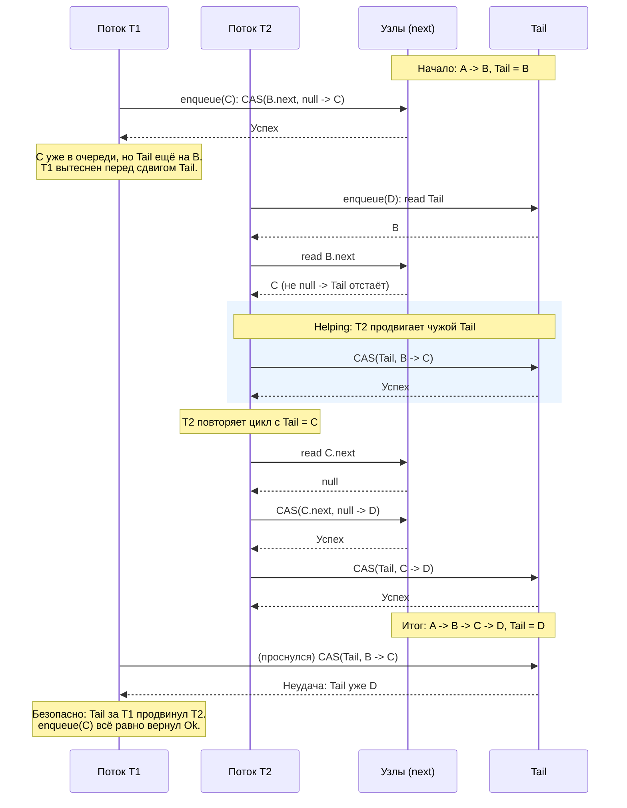

# Michael-Scott Queue (lock-free, helping)

## Обзор

Реализация **lock-free MPMC-очереди Майкла-Скотта** на связном списке узлов. Главная тема -
механика **helping** (кооперативное дозавершение чужой операции). Попутно модуль показывает, чем
слабая модель памяти C11 отличается от sequential consistency, и почему безопасное освобождение
узлов в lock-free структурах - отдельная тяжёлая проблема (из-за которой мы узлы **не
переиспользуем**).

Узлы живут в **пуле фиксированной ёмкости** (`Box<[Node]>`), а "указатели" (`head`, `tail`, `next`)
это просто индексы в пуле (`AtomicUsize`, `NULL_INDEX` = конца нет):

```rust
struct Node<T> {
    value: UnsafeCell<Option<T>>, // payload generic с move; см. раздел про payload
    next: AtomicUsize,            // индекс следующего узла; NULL_INDEX -> конец списка
}

struct MSQueue<T> {
    pool: Box<[Node<T>]>, // фиксированная ёмкость, без реаллокации; доступ по индексу
    bump: AtomicUsize,    // следующий невыданный индекс (bump-аллокатор, без реюза)
    head: AtomicUsize,    // индекс dummy-узла
    tail: AtomicUsize,    // индекс последнего (или предпоследнего) узла
}
```

> [!NOTE]
> Пул + индексы вместо реальных `AtomicPtr` выбраны специально: у `loom` нет настоящих адресов, а
> сырой `AtomicPtr` + освобождение узлов дал бы недетерминированный use-after-free. Пул делает
> демонстрацию детерминированной и совместимой с `loom` / `Miri`.

**Узлы не переиспользуются**: `enqueue` берёт свежий индекс bump-аллокатором, `dequeue` снятые узлы
не освобождает. Это делает очередь провабельно корректной на `acq_rel` **без hazard pointers**: раз
узел никогда не возвращается в пул, ABA и use-after-free невозможны. Цена - ограниченная ёмкость на
всё время жизни (снятые слоты не возвращаются в оборот). Почему мы пошли на это упрощение, а не на
реюз - в разделе [про освобождение узлов](#почему-мы-не-переиспользуем-узлы).

## Структура и инвариант

Инвариант Майкла-Скотта: очередь **всегда непуста** за счёт **dummy-узла**. `head` указывает на
dummy (уже снятый элемент), `tail` - на последний узел или отстаёт на один шаг во время гонки.

```
head                           tail
  |                              |
  v                              v
[dummy] --next--> [A] --next--> [B] --next--> NULL
```

Ключевое свойство инварианта: **узел с `next == NULL` - это последний узел (хвост)**. Отсюда: "у
dummy нет преемника" эквивалентно "очередь пуста". Это свойство - единственный надёжный признак
пустоты (см. раздел про слабую память).

## Helping - сердце алгоритма

`enqueue` состоит из **двух шагов**, и между ними структура на мгновение неконсистентна:

```rust
// шаг 1: пристегнуть новый узел к tail.next (Release публикует value/next узла)
if self.node(t).next
    .compare_exchange(NULL_INDEX, new_idx, Ordering::Release, Ordering::Relaxed)
    .is_ok()
{
    // шаг 2: продвинуть tail на новый узел (best-effort, промах не критичен)
    let _ = self.tail.compare_exchange(t, new_idx, Ordering::AcqRel, Ordering::Relaxed);
    return Ok(());
}
```

Если поток успел сделать шаг 1, но ещё не сделал шаг 2 (или вытеснен между ними), `tail` **отстаёт**:
`tail.next != NULL`. Любой другой поток, наткнувшийся на это состояние (другой `enqueue` или
`dequeue`), **помогает**: сам продвигает `tail`, прежде чем действовать дальше.



Именно helping даёт **lock-freedom**: прогресс системы не зависит от того, доживёт ли конкретный
поток до конца своей операции.

## Почему мы не переиспользуем узлы

Заманчиво освобождать снятые узлы обратно в пул (freelist) и класть в них новые элементы. Но
безопасное освобождение узла в lock-free структуре - это **вопрос времени выполнения**, а не типов,
и наивно оно не работает.

- **Сырой индекс из-под атомика.** Поток A сделал `h = head.load()` (индекс `i`) и вытеснен. Поток
  B снял `i` и вернул его в пул. A просыпается и читает `node(i).next` - обращается к узлу, который
  уже "не тот". Для borrow-checker `i` это просто `usize`, не заимствование; он не видит, что A ещё
  держит узел. Move-семантика Rust опирается на **уникального** владельца, а узел здесь
  **разделяемо достижим** из-под атомика - поэтому move её не решает.

- **Окно в атомарном `Arc`.** Даже `Arc<Node>` не спасает из коробки: A загрузил указатель ->
  вытеснен -> B уронил refcount до 0, узел освобождён -> A делает `clone` (инкремент счётчика
  **освобождённого** узла) -> UAF. Это и есть проблема, ради которой существуют `arc-swap`, hazard
  pointers, epoch-based reclamation.

- **Реюз оживляет ABA.** Освобождённый и заново выданный индекс возвращается "тем же", и CAS,
  сравнивающий только индекс, ошибочно проходит. Классическая защита - **tagged pointers**: к
  индексу добавляют version-счётчик, растущий на каждом реюзе, и сравнивают пару `(index,
  version)`. Схематично:

  ```
  observed = (i, v)      поток A прочитал узел i поколения v
  actual   = (i, v+2)    узел i сняли, освободили, выдали заново -> поколение выросло
  index(observed) == index(actual)   // сравнение по индексу: ABA НЕ замечена
  observed        != actual          // сравнение по (index, version): CAS провалится
  ```

- **Но тег - это не безопасное освобождение.** Version-тег ловит ABA на конкретном CAS, но **не**
  устраняет ни use-after-free, ни гонку на переиспользуемом `value`, ни порчу структуры, когда
  устаревшее чтение `tail` уводит `head` за освобождённый узел. Полный корректный реюз требует
  настоящего reclamation (**hazard pointers** или **epoch-based**), а это отдельная большая тема.

Поэтому здесь мы выбираем простоту и провабельную корректность: **bump-аллокация без реюза**. Узел
живёт вечно, значит ни ABA, ни UAF, ни гонки на `value` - и никаких тегов и hazard pointers не нужно.
Это честный вывод демо: lock-free reclamation узлов - это про конкурентных читателей, которых система
типов не видит сквозь атомик, и дёшево он не даётся.

## Payload: generic `T` с move

Payload - произвольный `T` (`Option::take` вынимает значение по move, `T` не обязан быть `Copy`).
Тонкость в том, что несколько потребителей одновременно нацеливаются на один узел, а победит CAS над
`head` только один. Поэтому значение **вынимаем только после победы CAS**:

```rust
if self.head.compare_exchange(h, next, AcqRel, Acquire).is_ok() {
    // мы - единственный победитель; node(next) стал новым dummy
    return unsafe { (*self.node(next).value.get()).take() };
}
```

Почему это безопасно **без** `Copy` и без реюза:

- **Эксклюзивность.** После `CAS(head: h -> next)` голова уже равна `next` и двигается только вперёд,
  а индексы не выдаются повторно - никто больше никогда не нацелится на `next`. Значит `value` этого
  узла трогает лишь победитель. (При реюзе `take` был бы опасен: между победой и `take` узел мог быть
  освобождён и переиспользован - ровно поэтому реюз-версия читала значение до CAS и упиралась в `Copy`.)
- **Видимость.** Запись `value` в `enqueue` идёт до публикации узла (Release на `next`), а победитель
  до `take` уже сделал Acquire-загрузку `next` - happens-before гарантирует, что значение видно.
- **Дропы.** Снятое значение уносит получатель; не снятые (оставшиеся в очереди) дропаются при `drop`
  очереди вместе с `Box<[Node<T>]>`. Каждое значение дропается ровно один раз (см.
  `test_drops_each_value_once`).

Для произвольного `T` нет `Atomic<T>`, поэтому внутреннюю изменяемость даёт `UnsafeCell<Option<T>>`, а
доступ к нему - `unsafe`. Это единственный `unsafe` в модуле; он локализован и обоснован
эксклюзивностью + release/acquire по `next`. Класс `Send`/`Sync` заявлен вручную (`unsafe impl` для
`T: Send`).

## Пустота определяется по `next`, а не по сравнению `head` / `tail`

Тонкий, но принципиальный момент и отличная иллюстрация того, чем C11 отличается от sequential
consistency. Оригинальный алгоритм Майкла-Скотта (1996) доказан **в предположении sequential
consistency**. Наивный перенос `dequeue` выводит пустоту из сравнения `head` и `tail`:

```
h = head; t = tail; next = head.next
if h == t:                       // head == tail?
    if next == NULL: return None // пусто
    else: помочь продвинуть tail
else:                            // head != tail -> считаем, что элемент есть
    ... разыменовываем next ...  // ОПАСНО под слабой памятью
```

Под SC это корректно: если `head != tail`, то у dummy точно есть преемник (`head.next != NULL`),
глобально согласованный срез не даёт `head != tail` вместе с `head.next == NULL`.

**Под acquire/release такой срез возможен.** `Acquire`-загрузка `tail` вправе вернуть **устаревшее**
значение из modification order (acquire синхронизируется с тем, что прочитал, но **не обязан читать
самое свежее**). Тогда `tail` покажет старый узел, отличный от `head`, хотя очередь на самом деле
пуста (`head == реальный tail`, `head.next == NULL`). Ветка `else` разыменует `next == NULL` -> в
исходном виде это была бы паника / порча. Именно этот несогласованный срез ловили `loom` / `Miri`.

Вывод: **источник истины о пустоте - только `next`**. Правильный `dequeue` проверяет `next == NULL`
до и независимо от `head` / `tail`, а `tail` использует лишь чтобы решить, надо ли помочь его
продвинуть (и разыменовывает `next` только когда `next != NULL`):

```rust
let h = self.head.load(Ordering::Acquire);
let next = self.node(h).next.load(Ordering::Acquire);
if h != self.head.load(Ordering::Acquire) { continue; } // node(h) всё ещё dummy

if next == NULL_INDEX {
    return None; // пусто - решаем по next, НЕ по tail
}

let t = self.tail.load(Ordering::Acquire);
if h == t {
    // tail отстаёт -> помочь продвинуть и повторить
    let _ = self.tail.compare_exchange(t, next, Ordering::AcqRel, Ordering::Relaxed);
    continue;
}
// head != tail и преемник есть -> безопасно снять
```

Здесь работает и второй устой корректности: **узлы не освобождаются**. Даже если устаревшее чтение
`tail` заставит `head` транзитно обогнать `tail`, это безопасно - `tail` всё равно указывает на
живой узел с валидным `next`, и helping его догонит. При реюзе тот же сценарий утащил бы `tail` на
освобождённый узел и потерял бы элемент (ровно поэтому реюз требует hazard pointers).

Урок: инварианты, "очевидные" при sequential consistency, **не переносятся** на слабую модель памяти
без проверки. Согласованных срезов между независимыми атомиками там нет.

## Выбор Memory Order

Очередь строится на паре **Release/Acquire** (полный `SeqCst` не нужен): публикация узла и его
видимость получателю идут по цепочке release/acquire на поле `next`.

### Публикация узла: attach-CAS на `next` (`Release`), загрузки `next` (`Acquire`)

`enqueue` сначала пишет `value` (в `UnsafeCell`, не атомарно - узел ещё эксклюзивно наш) и `next`
нового узла, затем **публикует** узел через attach-CAS с `Release`. Любой поток, прочитавший это поле
`next` с `Acquire`, попадает в отношение **synchronizes-with** с публикатором и через
**happens-before** видит записанное `value`. Поэтому `value` в `dequeue` можно вынимать `take`-ом без
собственной атомарности: видимость обеспечивает предшествующая `Acquire`-загрузка `next`, а
эксклюзивность - победа в CAS над `head`.

### CAS над `head` / `tail`: `AcqRel`

Это точки, где RMW одновременно **публикует** своё изменение (release-часть) и **видит**
согласованный **modification order** атомика (acquire-часть). `AcqRel` на успехе, `Acquire` или
`Relaxed` на неуспешной ветке (мы просто перечитаем и повторим). Version-тегов здесь нет: без реюза
индекс не возвращается, поэтому ABA на `head` / `tail` невозможна и тег не нужен.

### Первичные загрузки `head` / `tail`: `Acquire`

Загрузка должна попасть в **happens-before** с публикатором соответствующего изменения, чтобы видеть
связанные записи (узел за указателем, поле `next`). Важная оговорка из раздела про пустоту: `Acquire`
даёт видимость **того значения, которое реально прочитано**, но **не** гарантирует чтение самого
свежего значения. Поэтому по одиночной `Acquire`-загрузке `tail` нельзя делать вывод о структуре
очереди - решение о пустоте принимается по `next`.

## Итого

| Операция                         | Memory Order               | Причина                                                                             |
|----------------------------------|----------------------------|-------------------------------------------------------------------------------------|
| `next` attach-CAS (success)      | `Release`                  | Публикует новый узел (`value` + `next`) для потоков, читающих `next` с `Acquire`    |
| `next.load`                      | `Acquire`                  | Строит **synchronizes-with** с публикатором узла -> видимость `value` и связей      |
| запись `value` (подготовка узла) | не атомарно (`UnsafeCell`) | Узел ещё эксклюзивно наш; видимость даст `Release` на attach-CAS ниже               |
| `value.take()` (в `dequeue`)     | не атомарно (`UnsafeCell`) | Только победитель CAS; видимость - от `Acquire`-загрузки `next`                     |
| `head` / `tail` CAS              | `AcqRel`                   | RMW публикует изменение и видит **modification order** (тегов нет - реюза нет)      |
| `head` / `tail` load             | `Acquire`                  | Видимость прочитанного значения; но НЕ гарантия свежести - пустоту решаем по `next` |
| CAS (failure branch)             | `Acquire` / `Relaxed`      | Изменение не применилось - просто перечитываем и повторяем                          |

Пара **Release/Acquire** это минимально необходимый и достаточный набор для корректной работы
очереди в рамках [декларативной модели памяти](../../README.md#11-порядки-и-отношения): она даёт
видимость данных узла через `next` и согласованный порядок обновлений `head` / `tail` через
**modification order**, без накладных расходов полного **synchronization order** (`SeqCst`).

> [!NOTE]
> Единственный `unsafe` в модуле - доступ к `UnsafeCell<Option<T>>` под generic-payload с move (плюс
> ручной `unsafe impl Send/Sync`). Он локализован и обоснован эксклюзивностью доступа и цепочкой
> release/acquire по `next`. Вся остальная синхронизация идет через безопасные атомики и индексы пула.
> При `usize`-payload можно было бы обойтись `AtomicUsize` и вовсе без `unsafe` - это размен generic
> `T` против "нуля unsafe" (см. раздел про payload).
